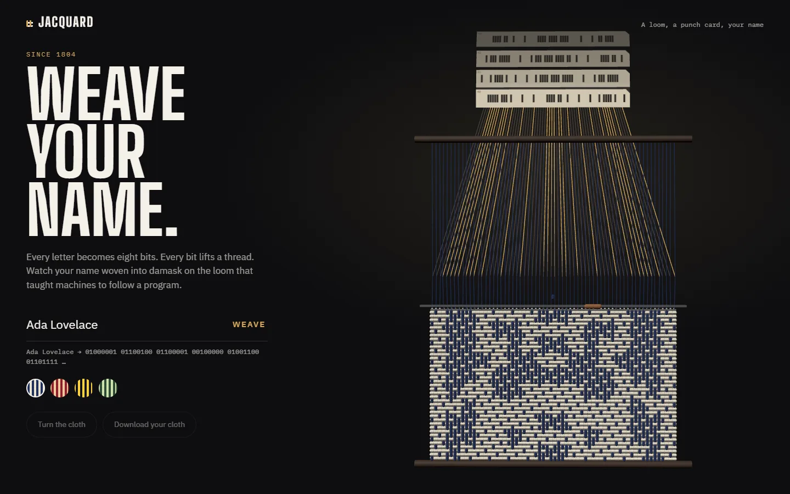
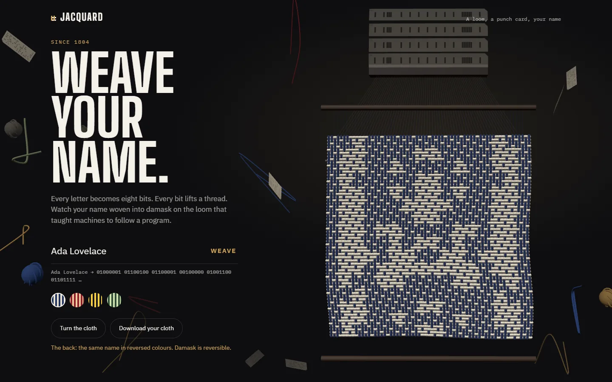

# Jacquard

**Live:** https://jacquard-loom.vercel.app

Type your name and watch a 3D loom weave it into damask, bit by bit. A small tribute to the punch-card loom that taught machines to follow a program, built by a textile designer who became a software engineer.



## How a name becomes cloth

1. **Name to bits.** The name is encoded as UTF-8, so `A` is `01000001` and letters like `õ` take two bytes.
2. **Bits to a draft.** Each bit covers a 4 × 4 block of thread crossings and decides whether that block is *figure* or *ground*. The motif is mirrored left to right, like a textile repeat.
3. **Draft to weave.** As in a real damask, the figure is a five-end warp satin (warp on top at four of every five crossings) and the ground is the same satin turned over, so the name shows in two colours from a single pair of threads.
4. **Weave to card.** Each row of the draft is one punch card: a hole lifts that warp thread. The card under the loom shows the row being woven.

The logic lives in [`src/weave.ts`](src/weave.ts) and is unit-tested, including that the figure really is warp-faced, the ground weft-faced, and no thread floats loose for more than four crossings.

## The loom

[`src/loom.ts`](src/loom.ts) is plain Three.js, built to show cause and effect:

- **Card → cord → thread.** A chain of punch cards steps through the Jacquard head, one card per row. Harness cords run from the head to every warp thread; the ones the current card has holes for light up brass and pull their threads forward, opening the shed the shuttle passes through.
- **The cloth** is two `InstancedMesh` layers of 4,096 capsules each, front and back. A damask is reversible: wherever the warp shows on the front, the weft shows on the back, so the back carries the same name in reversed colours.
- **Off the loom.** When the last row is beaten in, the cloth comes off, ripples in the air (a vertex shader adds a wave that grows away from the top edge) and turns to show its back. Drag it, or press *Turn the cloth*, to turn it again.
- Only the row being woven is re-placed and uploaded to the GPU each frame; everything else stays put.
- Motion stops for visitors who prefer reduced motion: the cloth appears finished and stays still.



The finished cloth can be downloaded as a PNG, drawn flat thread by thread in [`src/export.ts`](src/export.ts). A link with `?name=` weaves that name.

Type is IBM Plex, a nod to the punch-card lineage, with Big Shoulders Display for the machine.

## Stack

Three.js · TypeScript · Vite · Vitest · no framework

## Run it

```bash
npm install
npm run dev
npm test
npm run build
```
